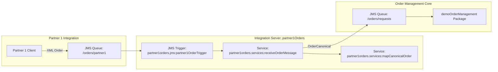

# partner1Orders

webMethods Integration Server package implementing the inbound partner integration (first half-flow) for processing order messages from Partner 1.

---

## 1. Overview & Architecture

The `partner1Orders` package receives Partner 1 XML purchase orders from a dedicated Universal Messaging (UM) JMS queue, transforms them into the enterprise canonical format (`demoCanonicalDataFormats.docTypes:OrderCanonical`), and forwards the canonical order to the internal order request processing queue.



---

## 2. Package Structure

- **Package Name:** `partner1Orders`
- **Target Server Version:** `12.1.0.0+`
- **Dependencies:** `demoCanonicalDataFormats`, `WmPublic`, `WmJMS`

```text
partner1Orders/
├── partner1orders/
│   ├── docTypes/
│   ├── jms/
│   │   └── partner1OrderTrigger          (JMS Trigger listening on /orders/partner1)
│   └── services/
│       ├── mapCanonicalOrder             (Data mapping to canonical model)
│       └── receiveOrderMessage           (JMS Trigger handler / pipeline processor)
└── resources/
    └── test/
        ├── setup/
        │   └── partner1OrdersMappingSuite.xml
        └── data/
            └── partner1OrdersMappingSuite/
                ├── testMapCanonicalOrderSuccess_input.xml
                ├── testMapCanonicalOrderSuccess_expected.xml
                ├── testMapSingleItemAndSpecialChars_input.xml
                ├── testMapSingleItemAndSpecialChars_expected.xml
                ├── testMapFieldAssertions_input.xml
                ├── testRejectInvalidDateFormat_input.xml
                ├── testRejectMissingDate_input.xml
                └── testRejectEmptyPayload_input.xml
```

---

## 3. Services & Mapping Specification

### 3.1. `partner1orders.services:mapCanonicalOrder`

Pure mapping service that transforms the Partner 1 order structure into the canonical model.

#### **Input Signature:**
- `request` (Document)
  - `orderRequest` (Document)
    - `id` (String) - Order identifier
    - `date` (String) - ISO 8601 date string (`yyyy-MM-dd'T'HH:mm:ss.SSS`)
    - `currency` (String) - ISO currency code (e.g., `EUR`, `USD`)
    - `customer` (Document: `id`, `name`, `email`)
    - `shippingAddress` (Document: `street`, `city`, `postalCode`, `country`)
    - `items` (Document)
      - `item` (Document List: `id`, `name`, `quantity`, `unitPrice`)

#### **Output Signature:**
- `orderCanonical` (Document Reference: [`demoCanonicalDataFormats.docTypes:OrderCanonical`](demoCanonicalDataFormats.docTypes:OrderCanonical))

#### **Transformation Rules:**
| Source Field | Target Field (`orderCanonical`) | Rule / Transformation |
| :--- | :--- | :--- |
| `request/orderRequest/id` | `id` | Direct copy |
| `request/orderRequest/date` | `date` | Formatted via `pub.date:dateTimeFormat`<br>`yyyy-MM-dd'T'HH:mm:ss.SSS` → `yyyy-MM-dd HH:mm:ss.SSS` |
| *(static)* | `status` | Set fixed value: `"received"` |
| `request/orderRequest/currency` | `currency` | Direct copy |
| `request/orderRequest/customer` | `customer` | Direct copy |
| `request/orderRequest/shippingAddress` | `shippingAddress` | Direct copy |
| `request/orderRequest/items/item` | `items` | Array mapping: direct copy of item records |

---

### 3.2. `partner1orders.services:receiveOrderMessage`

Trigger service invoked upon receipt of a JMS message from Universal Messaging.

1. **Log**: Records incoming message details using `pub.flow:debugLog`.
2. **Parse XML**: Converts JMS message string body (`xmldata`) into an XML DOM and parses it into a pipeline document via `pub.xml:xmlStringToEnhancedXMLNode` and `pub.xml:xmlNodeToDocument`.
3. **Map**: Calls [`partner1orders.services:mapCanonicalOrder`](partner1orders/services/mapCanonicalOrder) to generate `orderCanonical`.
4. **Publish JMS**: Dispatches the resulting canonical order document to `/orders/requests` using `pub.jms:send` over `DEFAULT_IS_JMS_CONNECTION`.

---

## 4. JMS Configurations

| Element | Name | Configuration / Notes |
| :--- | :--- | :--- |
| **Inbound Queue** | `/orders/partner1` | Destination for incoming partner XML orders |
| **JMS Trigger** | `partner1orders.jms:partner1OrderTrigger` | - Connection Alias: `DEFAULT_IS_JMS_CONNECTION`<br>- Destination: `/orders/partner1` (Queue)<br>- Processing Mode: Concurrent (Max 1 thread)<br>- Routing Rule: Dispatches to `partner1orders.services:receiveOrderMessage` |
| **Outbound Queue** | `/orders/requests` | Universal Messaging queue consumed by `demoOrderManagement` |

---

## 5. Unit Testing & Quality Assurance

The package includes automated Unit Test Framework (UTF) test cases in suite `partner1OrdersMappingSuite`:

| Test Name | Type | Coverage / Objective |
| :--- | :--- | :--- |
| `testMapCanonicalOrderSuccess` | Pipeline snapshot | Verifies standard multi-item payload mapping. |
| `testMapSingleItemAndSpecialChars` | Pipeline snapshot | Validates single-item lists, accents, and special characters. |
| `testMapFieldAssertions` | JXPath Assertions | Validates individual field transformations (`status == 'received'`, date format, customer). |
| `testRejectInvalidDateFormat` | Exception assertion | Ensures `ServiceException` (`ISS.0086.9189`) is thrown on non-conformant date strings. |
| `testRejectMissingDate` | Exception assertion | Ensures `ServiceException` is thrown when `date` is missing. |
| `testRejectEmptyPayload` | Exception assertion | Ensures `ServiceException` is thrown on empty payloads. |

---

## 6. Verification & End-to-End Testing

1. **Run Unit Tests**:
   - Execute the test suite `partner1OrdersMappingSuite` using the test runner or MCP tool `test_run`.
2. **End-to-End Verification**:
   - Post sample XML ([`requirements/samples/order.xml`](requirements/samples/order.xml)) to queue `/orders/partner1`.
   - Query the Order REST API to verify canonical ingestion and database persistence:
     ```http
     GET /restv2/orders/{orderId}
     Authorization: Basic Administrator:manage
     ```
